# Personal Learning Library

A private school for one: you tell Claude Code what you want to learn, it writes short, beautiful
lessons for you, and a local app lets you read them with a tutor in the margin. The app records what you
struggled with, and the next lesson is built around those gaps.

It runs entirely on your computer and uses **your own Claude Code sign-in** (no API key).

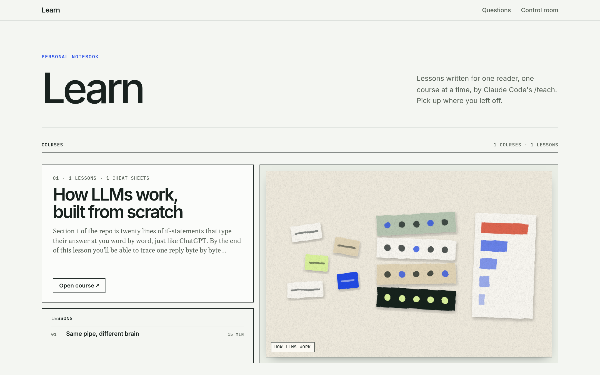

## What's in the box

| Part | Folder | What it does |
|---|---|---|
| The teacher | `skill/teach/` → `~/.claude/skills/teach` | The `/teach` skill for Claude Code. It interviews you, finds good sources, and writes one lesson at a time into your library. |
| The library | `library/` → `~/learning-library` | Plain files: one folder per course with lessons (HTML), cheat sheets, your learning records and progress. Ships with one demo course, **How LLMs work**. |
| The app | `app/` | A Next.js app that reads the library, adds a canvas, a tutor, quizzes, a Journey page and a Control room, and writes what you did back into the library. |

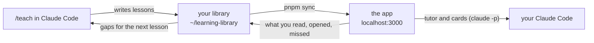

## Install

You need **Node.js 20+**, **pnpm** (or corepack), **python3**, **git**, and
[Claude Code](https://claude.com/claude-code) installed and signed in. Works on Linux and macOS.

```bash
git clone https://github.com/wilfredeveloper/personal-learning-library
cd personal-learning-library
./install.sh                       # library goes to ~/learning-library
# or: LIBRARY_DIR=~/notes/learning ./install.sh
```

The installer:
1. creates your library from `library/` (it never overwrites an existing one),
2. installs the `teach` skill to `~/.claude/skills/teach` (an existing `teach` skill is moved to `teach.backup-<date>` first) and starts a git history for it,
3. installs the app's packages and publishes your courses into the app.

Then start the app:

```bash
cd app && pnpm dev                 # open http://localhost:3000
```

## Your first ten minutes

1. **Take the demo lesson.** Open the app, click **How LLMs work, built from scratch**, then lesson 1.
   It's a companion to the open-source repo [w3cj/how-llms-work](https://github.com/w3cj/how-llms-work); clone it next to you if you want to do the "your turn" tasks.
2. **Ask for something new.** Open Claude Code in any folder and type:
   ```
   /teach linear algebra for machine learning
   ```
   The first time, it asks you a few questions (why you want this, what you know, how you like to learn) and
   saves your answers in `LEARNER.md`. Then it finds sources, writes a mission and your first lesson.
3. **Publish it into the app:** `cd app && pnpm sync` (the teacher usually does this for you at the end of a lesson).
4. **Come back for the next one.** Either type `/teach <course>` again, or press **Ask for the next lesson** in the app.

---

## The features, and how to use them

### 1. The library

The home page shows every course as a card with its own cut-paper cover. The demo course has a hand-made
cover; every new course gets a generated one, seeded from its name, so no two look alike.
Click a course to see its lessons in order and its cheat sheets.

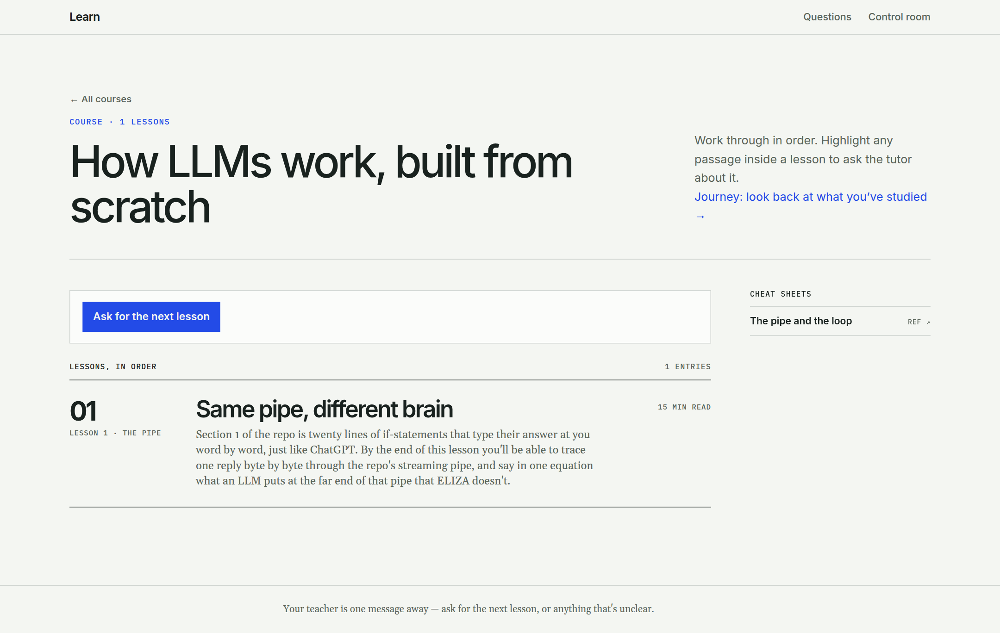

From the course page you can open a lesson, a cheat sheet, the **Journey** (section 8), or **Ask for the next lesson** (section 9).

### 2. The canvas: read a lesson and pull on any word

A lesson opens on a canvas: the page sits on a dotted board with room around it for your notes.

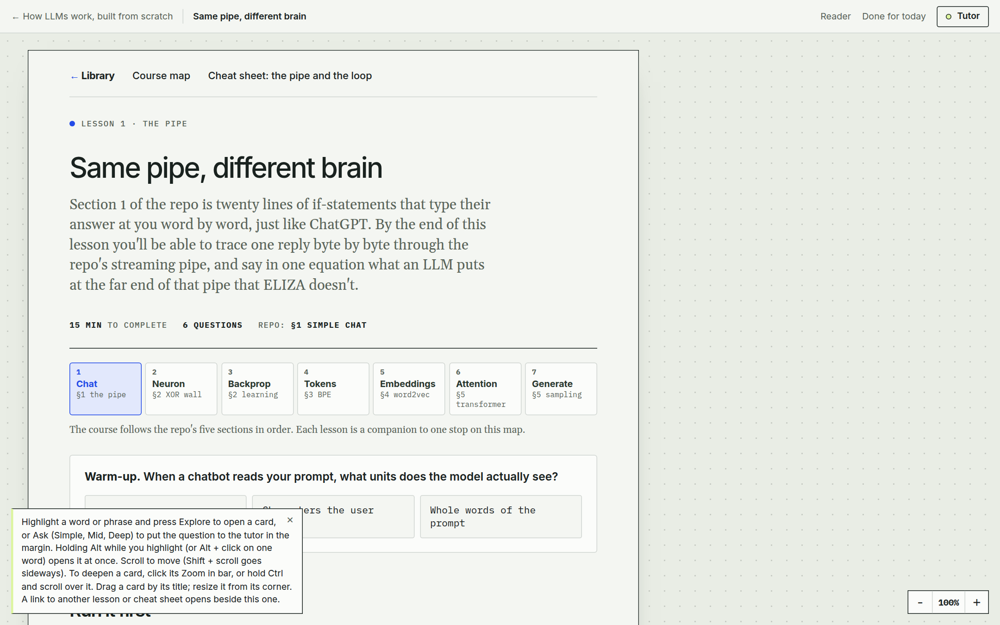

**Highlight** any word or phrase. A small bar appears:

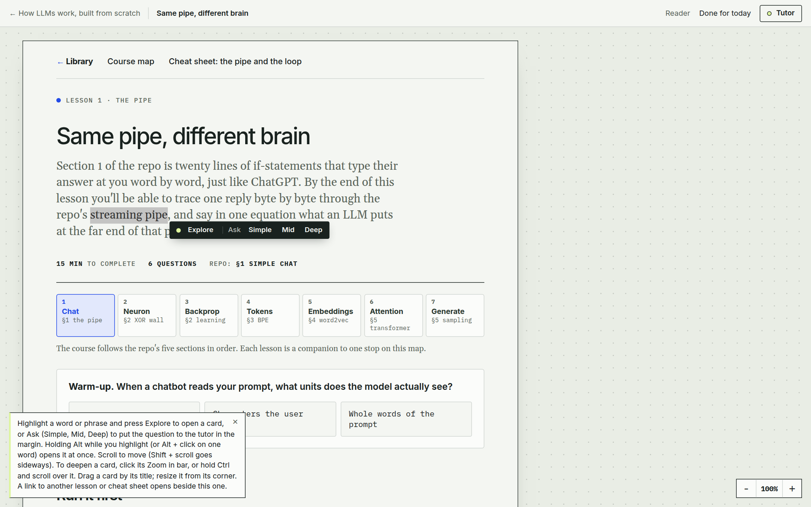

- **Explore** opens a **card** beside the text with a one-line definition.
- **Ask · Simple / Mid / Deep** sends the passage to the tutor instead (section 3).
- Shortcut: hold **Alt** while you highlight, or **Alt + click** a single word, to open a card at once.

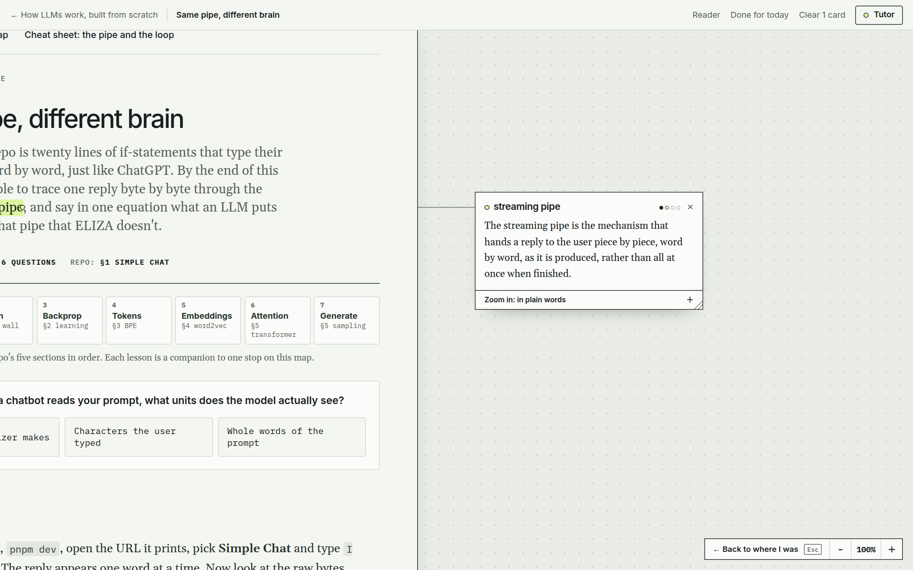

**Deepen a card.** Every card has four levels: *definition → in plain words → how it works → picture*.
Click the **Zoom in** bar at the bottom of the card (or hold Ctrl and scroll over it) to go one level deeper.
At "how it works" you get the real mechanism, with formulas and every symbol explained:

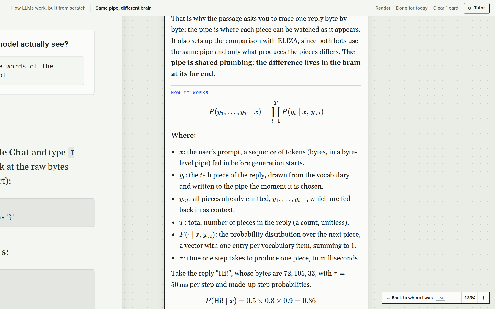

More things you can do on the canvas:
- **Highlight inside a card** to open a card about *that* term. You can follow a chain of ideas as far back as you need.
- **Drag** a card by its title and **resize** it from its corner. Cards are saved, so they're still there tomorrow.
- **Scroll** to move around, **Shift + scroll** to go sideways, and use **− / +** to zoom. **Esc** takes you back to where you were.
- **Clear N cards** (top bar) tidies the board.

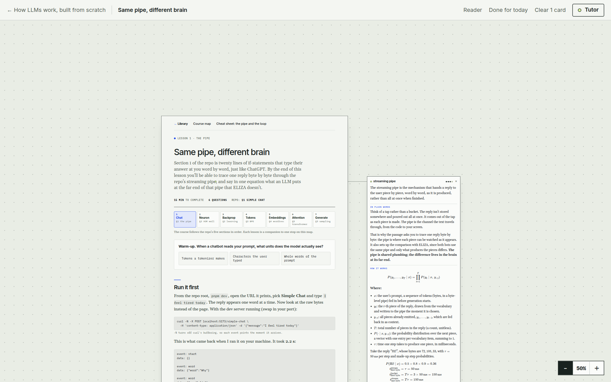

**Sources open beside the lesson.** When a course is published, every link in it is checked once.
A lime dot means the page opens right on the canvas, and a **PDF** tag means it's a PDF the canvas can show.
A ↗ means the site can't be shown inside the app, so it opens in a normal browser tab.
You can highlight text in an opened page too.

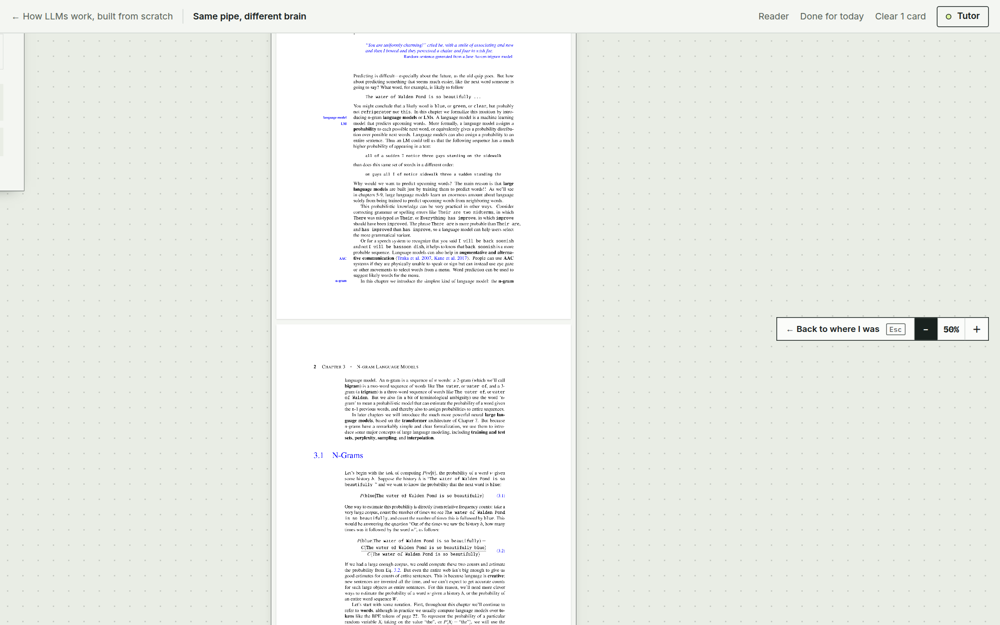

### 3. The reader and the tutor

Prefer a classic page? Press **Reader** in the top bar. Highlight a passage and pick a depth:

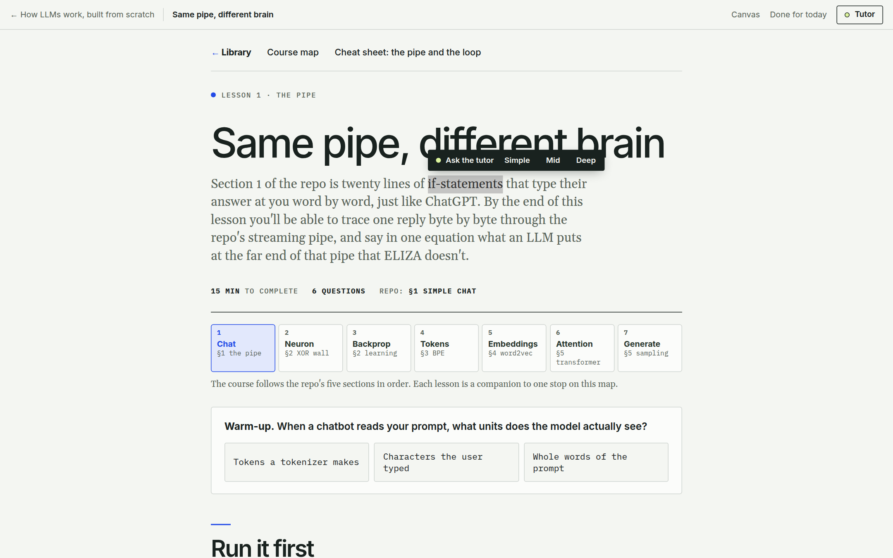

The tutor answers in the side panel, grounded in that lesson. The passage stays highlighted, so you can see
what the answer is about. Ask follow-ups in the box at the bottom.

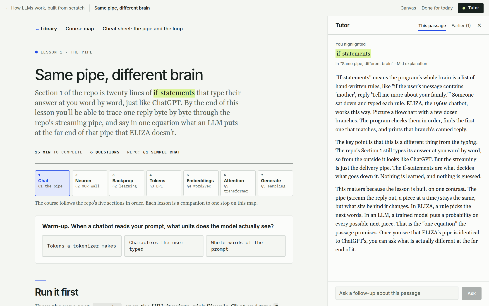

| Depth | Use it when | Model by default |
|---|---|---|
| Simple | you need the idea in one breath | Haiku |
| Mid | you want the idea and why it matters here | Sonnet |
| Deep | you want the mechanism and the maths | Sonnet |

The **Earlier** tab lists what you've asked in this lesson before. Every question in every course is also on the **Questions** page (section 7).

### 4. Quizzes that teach

Lessons have warm-ups, check-yourself quizzes and "your turn" tasks. A wrong answer gives you a hint,
not the answer, so you try again. Your first try is what counts as evidence for the teacher.

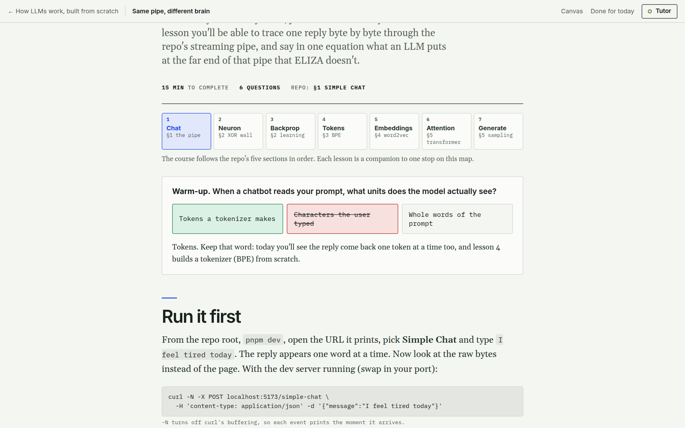

### 5. Done for today

When you stop, press **Done for today**. You can leave one optional line about anything still unclear.
The teacher reads it word for word before writing your next lesson.

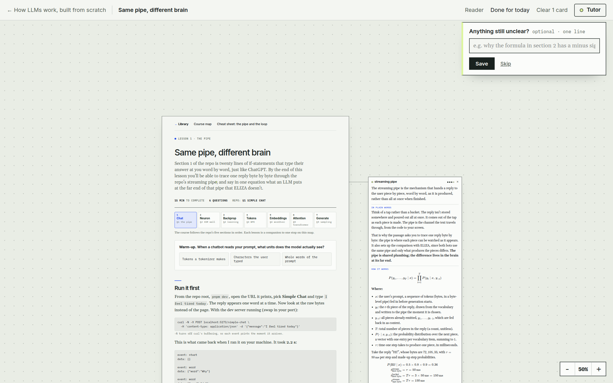

### 6. The asks: short retrieval practice, only when it helps

The app asks for at most about two minutes per session, and every ask can be skipped:
- **From last time.** When you open a lesson, the app may show up to 3 multiple-choice warm-up questions built from your own gaps (a term you looked up twice, a quiz you missed). One click each, graded on the spot.
- **Still clear?** If you've been away for 2 days or more, it shows a few terms from last time with *Yes / Not yet / Skip*.
- **Recall first?** When you open a card for a term you already looked up in an earlier session, it asks you to recall it before showing your old card.

These only appear once you have some history, so a fresh install won't show them yet (no screenshot here).

### 7. Questions

**Questions** (top bar) is the history of everything you've asked the tutor, across all courses. You can remove any of it here.

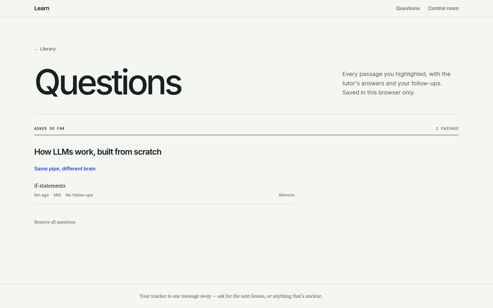

### 8. Journey: look back at what you studied

Each course has a Journey page:
- how long you read each section,
- which terms you opened, and the trail from term to term,
- how deep you went,
- your quiz results.

Press **Replay** to watch a session play back. Nothing here needs doing. It's for you, and the teacher reads the same data.

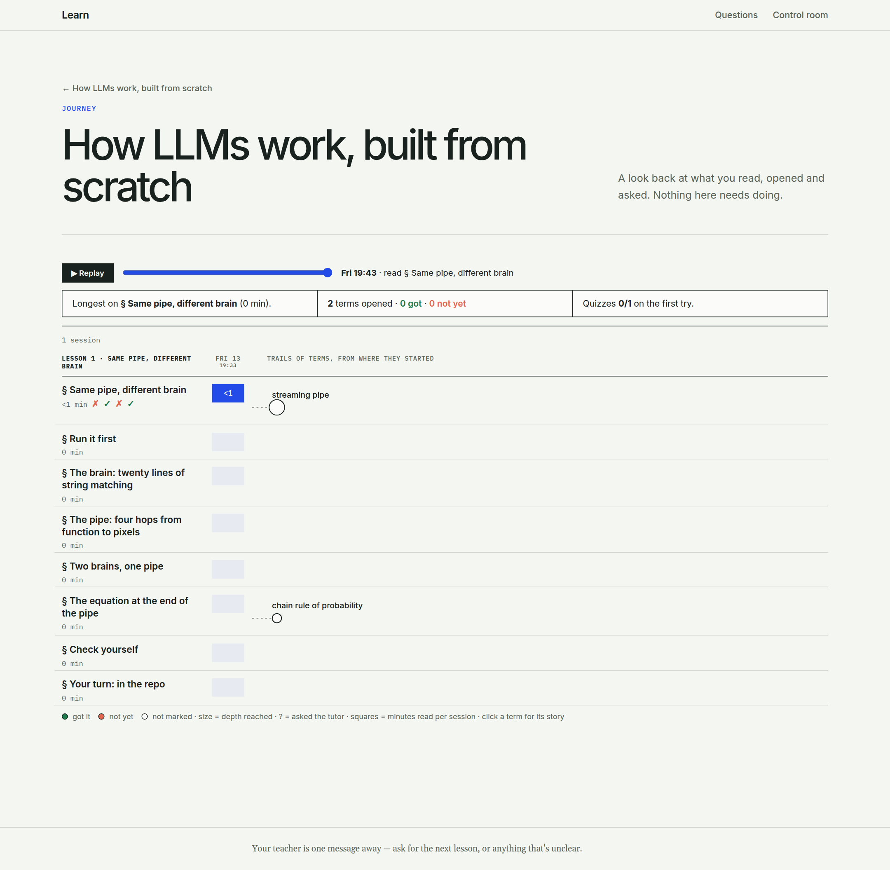

### 9. Ask for the next lesson, from the app

On a course page, press **Ask for the next lesson**. Optionally type your answers to the last lesson's "your turn" tasks or what you want next, then **Send**.
Claude Code runs `/teach` in the background, unattended:
1. It reads your gaps.
2. It writes the lesson and its cheat sheet.
3. It checks the links and publishes the course.
4. The app tells you when the lesson is ready.

It uses Opus, capped at **$5** of list-price usage per lesson.

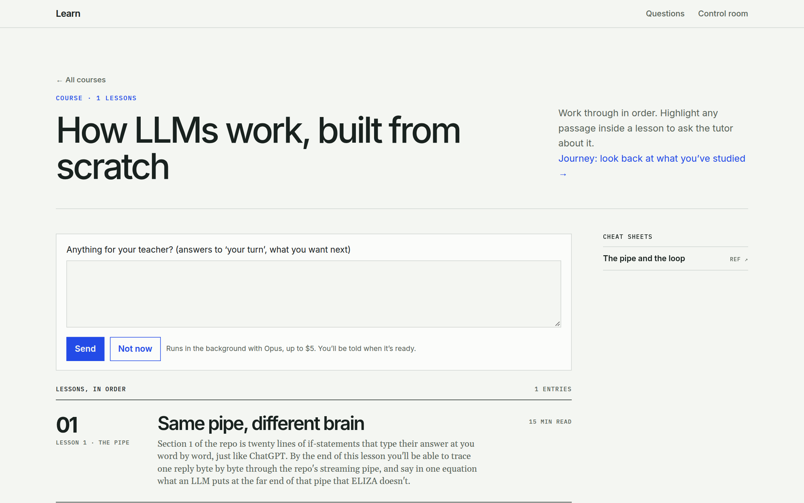

### 10. The Control room

**Control room** (top bar) has three tabs.

**Usage.** Every Claude call the app made:
- how many calls, how fast, and how many failed,
- what they would cost at list price, split by feature and by course.

On a Claude subscription you aren't billed per call; the price is shown so you can compare features.

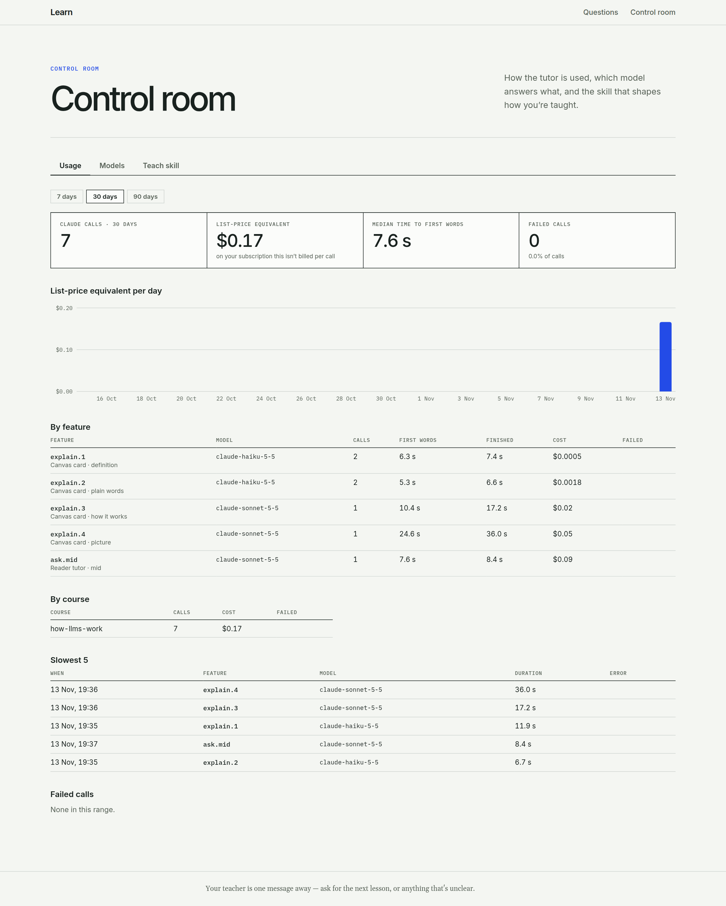

**Models.** Pick which model answers each feature (card depths, tutor depths, warm-ups, recall questions). You see each feature's measured speed and cost next to the dropdown. A change applies to the next call, with no restart.

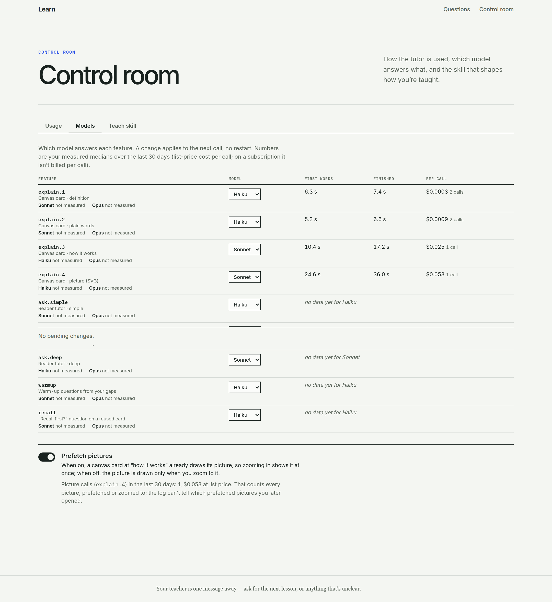

**Teach skill.** Read and edit the `/teach` skill itself, the instructions that shape how you're taught:
- Edit a file and see the diff before you save.
- Press **Review** to have Claude critique your edit against your learning records.
- Every save is a git commit, so any version can be restored.
- Changes made outside the app (by hand, or by Claude) show up here too, ready to commit.

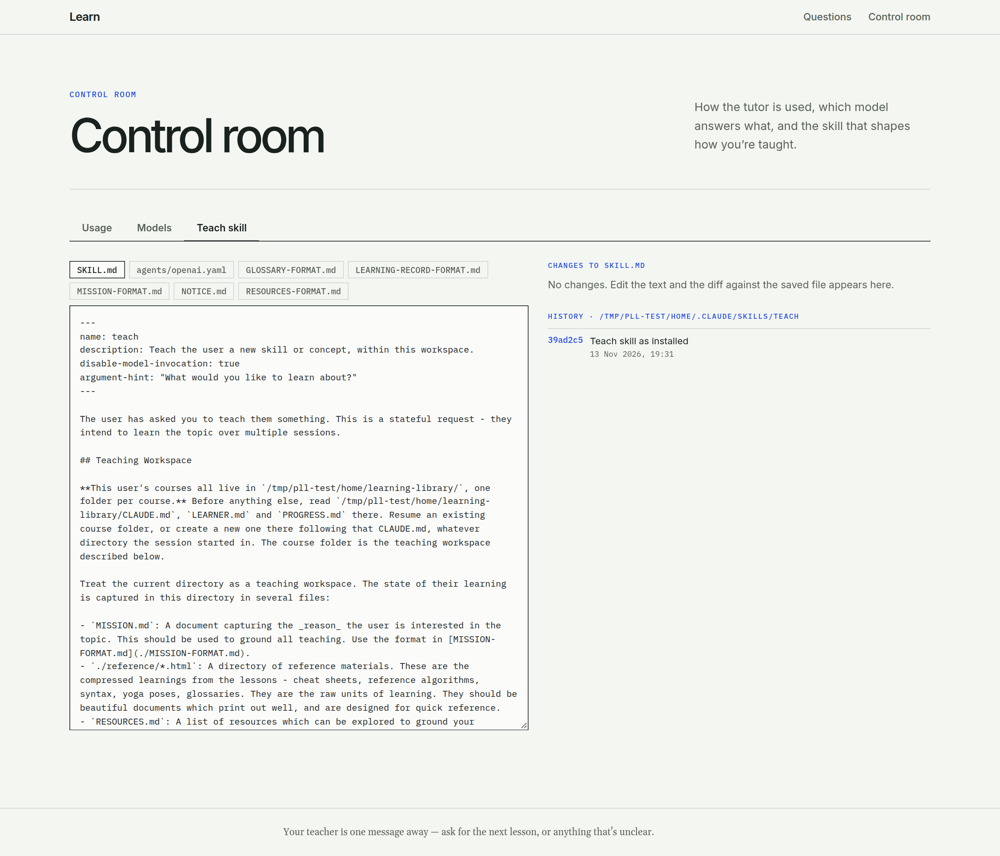

---

## How the loop works

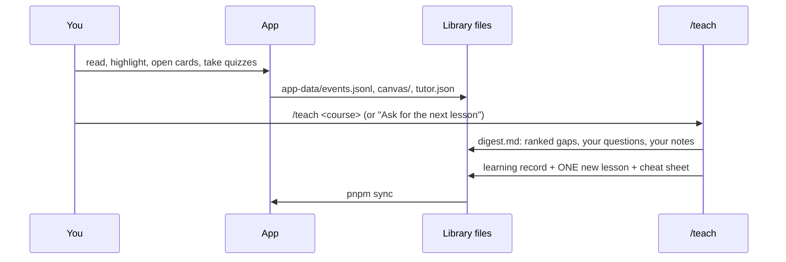

At the start of every session the teacher runs `node app/scripts/digest.mjs <course>`. That turns your activity into a one-page list of gaps, and the next lesson is aimed at them. What you *say* ("all clear!") counts less than what you *did* (quiz misses, terms you had to look up twice).

## Where things live

```
~/learning-library/
  CLAUDE.md          rules the teacher follows (house style, session routine)
  LEARNER.md         your learner profile (written in your first /teach session)
  PROGRESS.md        one row per course
  index.html         a static front page for the library (open it without the app)
  _shared/assets/    the shared look: course.css, quiz.js and other interactive pieces
  <course>/
    MISSION.md  RESOURCES.md  NOTES.md  GLOSSARY.md
    lessons/  reference/  learning-records/
    app-data/        written by the app: events, cards, tutor answers, digest
```

- Everything stays on your machine. The only thing sent anywhere is the Claude Code calls the app makes, the same as using Claude Code yourself.
- The lessons are plain HTML. They open in any browser without the app, and they're yours.
- The app finds your library through `app/.env.local` (`LEARNING_DIR=…`), which the installer writes.

## Useful commands

| Command (in `app/`) | What it does |
|---|---|
| `pnpm dev` | start the app on http://localhost:3000 |
| `pnpm sync` | publish every course in your library into the app (re-run after a lesson changes) |
| `NO_PREFETCH=1 pnpm sync` | the same, without re-checking links (offline) |
| `pnpm digest <course>` | write `app-data/digest.md`, the gap summary the teacher reads |
| `node scripts/check-links.mjs <course>` | check every link in a course the way the app opens them |

## Troubleshooting

- **The tutor or cards say they can't reach Claude.** Run `claude` in a terminal and make sure you're signed in; the app calls the same `claude` command.
- **A new lesson doesn't show up in the app.** Run `pnpm sync` in `app/`.
- **Maths shows as raw `\( … \)`.** KaTeX and the fonts load from a CDN, so you need internet when you read.
- **The app is local only.** It starts `claude` processes on your machine, so it won't work on serverless hosting such as Vercel.

## Uninstall

```bash
rm -rf ~/.claude/skills/teach          # restore teach.backup-<date> if you had one
rm -rf personal-learning-library       # the app
# your library (~/learning-library) is yours: keep it or delete it
```

## Credits and licence

- MIT licence, see [`LICENSE`](LICENSE).
- The `teach` skill builds on [mattpocock/skills](https://github.com/mattpocock/skills) (MIT, © Matt Pocock). See [`skill/teach/NOTICE.md`](skill/teach/NOTICE.md) for what changed.
- The demo course is a study companion to [w3cj/how-llms-work](https://github.com/w3cj/how-llms-work). It links to that repo and quotes one short snippet with attribution, and the repo's code isn't included here.
- Reading layout inspired by [divagr.com](https://divagr.com)'s article pages.
